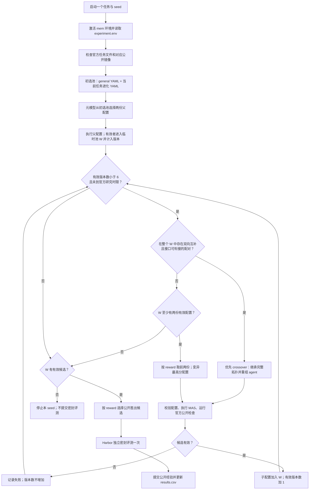

# MA-RSI

在 RSI-Exam 官方任务上，研究 agent 从通用 MAS 配置池选择两份父配置，使用各任务公开数据生成和检查候选，并将最终公开胜出产物交给 Harbor 独立密封验证。每个 seed 最多六个**通过公开自检**的版本；失败的生成或自检尝试另记在 `attempts.json`，不计版本。每个任务的研究时限从其 `task.toml` 的 `[agent].timeout_sec` 读取。

## 运行

以下六条命令分别放在六个终端，每条顺序跑三个 seed。研究运行不会自动重试已经完成的 seed；`outputs/` 中按时间保存每次运行。

```bash
ROOT=/data/user/wenxinyi/experiments/MA-RSI
STATE="$ROOT/repro/runner/state_current"
for seed in 11 22 33; do bash "$ROOT/repro/runner/run.sh" "$ROOT" "$STATE" bbo original "$seed"; done
for seed in 11 22 33; do bash "$ROOT/repro/runner/run.sh" "$ROOT" "$STATE" inventory original "$seed"; done
for seed in 11 22 33; do bash "$ROOT/repro/runner/run.sh" "$ROOT" "$STATE" graph original "$seed"; done
for seed in 11 22 33; do bash "$ROOT/repro/runner/run.sh" "$ROOT" "$STATE" cxr original "$seed"; done
for seed in 11 22 33; do bash "$ROOT/repro/runner/run.sh" "$ROOT" "$STATE" game2048 original "$seed"; done
for seed in 11 22 33; do bash "$ROOT/repro/runner/run.sh" "$ROOT" "$STATE" dcf original "$seed"; done
```

统一统计在 `repro/runner/state_current/results.csv`：每个 seed 的官方平台分数、官方原指标（如果 verifier 提供）、研究用时、密封评测用时、总用时、按模型可观测的 worker input/output/total token，以及已有 seed 的逐任务均值。均值行 `MEAN_1/2/3` 表示当前已完成样本数；三个 seed 全部结束后为 `MEAN_3`。元模型 token 和未提供 usage 的调用无法从现有日志可靠计数。

## 演化逻辑

通用候选池位于 `repro/pool/rsi-exam-general/`，运行时已经晋升的该任务 YAML 也加入初选池，由元模型选择两份。选中的父配置和后续所有自检有效的配置组成临时池 W。先枚举 W 的全部两两组合：同一组至少四个可比公开子样本，两边各在至少两个子样本占优，并存在相同 agent ID 的不同模型分配，才进行 EvoMAS 式交叉；继承一份完整拓扑，按对应位置重组 agent。否则从 W 取 reward 最高的两份，基于反馈变异其中分数最高的一份，仅选择 model_id 或 topology。新 agent 使用 s2 和八项基础研究工具。关联性证据不等于单个 agent 的因果优势；未满足条件的任务只进行变异。

`trajectory_evidence.jsonl` 保存操作与公开证据，`best_reward_config.yaml` 和 `best_visible_solver.py` 保存最终选择。公开的经验与角色摘要并发写入 `repro/memory/`、`repro/skill/`；密封分数只进入汇总与 manifest。新任务的官方公开包位于 `rsi_exam_tasks/`，没有打包密封测试。

## 当前实验流程

初选候选池包含 `repro/pool/rsi-exam-general/*.yaml`，以及当前任务的
`repro/pool/<task>/*.yaml`（包括此前晋升的进化配置）。元模型从这个候选池
选择两份父配置。通过公开检查的父配置及后续子配置组成**本轮临时池 W**。

`MAX_VALID_VERSIONS=6`：两份父配置若通过公开检查，也计入六个有效版本；
生成失败、配置校验失败或公开检查失败均不计数。


