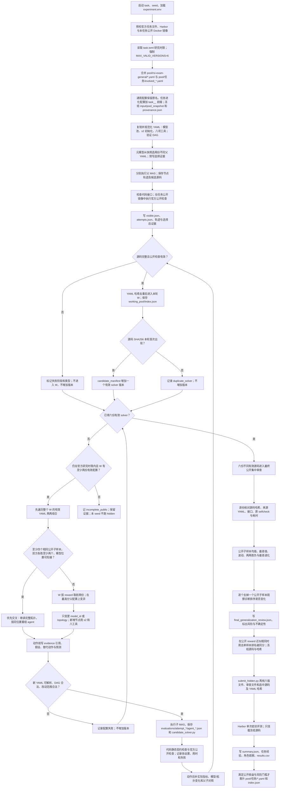

# MA-RSI

在 RSI-Exam 官方任务上，从通用池和当前任务的已进化池选择两份 MAS 父配置。配置 YAML 用于组织代码生成；本实验真正计数、集中审查和最终测评的对象是其生成的求解器源码。每个 seed 必须取得 **六份源码哈希不同、完整且通过官方公开 selfcheck 的 solver 版本**，然后才做最终公开泛化风险探索并将选中的一份交给 Harbor 密封评测。生成失败、配置无效、代码接口无效、selfcheck 失败和重复源码均不占六版名额。研究时限从任务 `task.toml` 的 `[agent].timeout_sec` 读取；到时不足六版时停止该 seed，保留证据但不跑 hidden。

## 运行

以下六条完整命令分别放在六个终端，每条顺序跑三个 seed。每个终端单独定义 `ROOT` 和 `STATE`。研究运行不会自动重试已经完成的 seed；`outputs/` 中按时间保存每次运行。

```bash
ROOT=/data/user/wenxinyi/experiments/MA-RSI; STATE="$ROOT/repro/runner/state_current"; for seed in 11 22 33; do bash "$ROOT/repro/runner/run.sh" "$ROOT" "$STATE" bbo original "$seed"; done
ROOT=/data/user/wenxinyi/experiments/MA-RSI; STATE="$ROOT/repro/runner/state_current"; for seed in 11 22 33; do bash "$ROOT/repro/runner/run.sh" "$ROOT" "$STATE" inventory original "$seed"; done
ROOT=/data/user/wenxinyi/experiments/MA-RSI; STATE="$ROOT/repro/runner/state_current"; for seed in 11 22 33; do bash "$ROOT/repro/runner/run.sh" "$ROOT" "$STATE" graph original "$seed"; done
ROOT=/data/user/wenxinyi/experiments/MA-RSI; STATE="$ROOT/repro/runner/state_current"; for seed in 11 22 33; do bash "$ROOT/repro/runner/run.sh" "$ROOT" "$STATE" cxr original "$seed"; done
ROOT=/data/user/wenxinyi/experiments/MA-RSI; STATE="$ROOT/repro/runner/state_current"; for seed in 11 22 33; do bash "$ROOT/repro/runner/run.sh" "$ROOT" "$STATE" game2048 original "$seed"; done
ROOT=/data/user/wenxinyi/experiments/MA-RSI; STATE="$ROOT/repro/runner/state_current"; for seed in 11 22 33; do bash "$ROOT/repro/runner/run.sh" "$ROOT" "$STATE" dcf original "$seed"; done
```

统一统计在 `repro/runner/state_current/results.csv`：每个 seed 的官方平台分数、官方原指标（如果 verifier 提供）、研究用时、密封评测用时、总用时、按模型可观测的 worker input/output/total token，以及已有 seed 的逐任务均值。均值行 `MEAN_1/2/3` 表示当前已完成样本数；三个 seed 全部结束后为 `MEAN_3`。元模型 token 和未提供 usage 的调用无法从现有日志可靠计数。

## 演化逻辑

通用候选池位于 `repro/pool/rsi-exam-general/`，运行时已经晋升的该任务 YAML 也加入初选池，由元模型选择两份。选中的父配置和后续所有自检有效的配置组成临时池 W。先枚举 W 的全部两两组合：同一组至少四个可比公开子样本，两边各在至少两个子样本占优，并存在相同 agent ID 的不同模型分配，才进行 EvoMAS 式交叉；继承一份完整拓扑，按对应位置重组 agent。否则从 W 取 reward 最高的两份，基于反馈变异其中分数最高的一份，仅选择 model_id 或 topology。新 agent 使用 s2 和八项基础研究工具。关联性证据不等于单个 agent 的因果优势；未满足条件的任务只进行变异。

`trajectory_evidence.jsonl` 保存操作与公开证据，`best_reward_config.yaml` 和 `best_visible_solver.py` 保存最终选择。公开的经验与角色摘要并发写入 `repro/memory/`、`repro/skill/`；密封分数只进入汇总与 manifest。新任务的官方公开包位于 `rsi_exam_tasks/`，没有打包密封测试。

## 当前实验流程与边界

下面的图按实际执行顺序展开。`YAML` 是多 agent 的执行配置，`candidate_solver.py` 是该配置一次运行生成的代码；只有后者通过官方公开 selfcheck，且源码 SHA256 在本轮首次出现，才算一个有效 solver 版本。2048 的官方提交文件名为 `policy.py`，DCF 为 `forecaster.py`，其他任务为 `solver.py`。



初选候选池的两个来源是 `repro/pool/rsi-exam-general/*.yaml` 和 `repro/pool/<task>/evolved_*.yaml`。后者只取当前任务此前晋升的进化 YAML；`index.json` 是溯源记录，不作为候选配置。运行脚本保留通用文件名，对任务进化文件添加 `task__` 前缀，避免同名文件覆盖，并把来源写入 `input/provenance.json`。元模型从冻结的初选池选择两份不同父 YAML，初始未选中的通用配置**不属于 W**。选中父配置经有效公开检查后进入本轮临时池 W；本轮子 YAML 也须通过检查才进入 W。W 按 YAML 文本哈希去重，独立于 solver.py 的版本哈希。交叉在整个 W 找可比的互补对；没有满足条件的组合才用 W 中 reward 前两份做变异。双向公开子样本优势只是配置关联证据，不能证明单个 agent 的因果优势。

失败尝试记录在 `attempts.json` 和 `trajectory_evidence.jsonl`，包括配置错误、节点/候选生成错误、代码接口及公开检查错误。`decision_evidence.jsonl` 分开写入事前选择依据与事后观察；元模型的变异理由另见 `mutation_rationales.jsonl`。`evaluations/<label>.yaml`、`evaluations/<label>/candidate_solver.py` 和 `visible.json` 保留每次具体配置、产物与公开分数；`candidate_manifest.json` 仅列出六份以内的不同有效 solver 源码。

只有恰好六份不同且经公开检查的源码，才运行最终公开泛化风险探索并冻结最终文件。`final_generalization_review.json` 汇集六份源码与 YAML 哈希、公开指标、各子样本、成本、最差子样本、子样本波动、两两胜负及去掉一个公开子样本后的诊断排名。先对全部六份源码建立风险画像，再选择公开 reward 最高的代码；若另有代码与最高分相差不超过 0.5%，且至少四个可比公开子样本存在，则在近似同分组中优先选去单样本后最差排名更好者。风险项和缺乏独立留出数据的不确定性同时保留，不把公开敏感性分析称为独立泛化证明。已记录的确定性 selfcheck 不重复运行；额外合法实例尚未自动构造。超过官方研究时间、W 不足两份有效配置或六版始终无法形成时，`summary.json` 记为 `incomplete_public`，`run.sh` 停止该 seed 的 hidden 和持久化步骤。

`submit_hidden.py` 要求六版、审查记录、冻结源码哈希一致，随后仅提交这一份代码。密封结果只写汇总和统计，不参与本轮选优。`state.py experiment-commit` 写任务内经验和角色摘要；当最终选中的是进化 YAML，公开指标严格优于两份父配置且集中审查没有风险标记时，才把它和对应 solver 哈希、谱系写到 `repro/pool/<task>/index.json`。这些门槛是保守的自动筛选，人工审查与跨任务因果验证仍须依据原始轨迹进行。

当前仍有研究设计中尚未自动实现的部分：元模型没有显式的“不变异／复测”动作，最终审查不会构造额外合法公开实例，也不会自动识别代码对公开答案的记忆；角色记录还是带来源的观察摘要，尚未完成控制变量的模型×职责×状态优势验证。自动晋升因此不能替代报告要求的人工复核。六任务运行命令、任务镜像和原有统计格式见上文。

## 与实验设计报告逐项核对

| 报告要求 | 当前实现和证据 | 尚待验证或实现 |
| --- | --- | --- |
| 任务协议和模型范围 | `task_preflight.py` 检查官方文件；`task_visible.py` 按任务调用公开镜像；`experiment.env` 固定元模型和四模型池；运行时读取官方 `task.toml` 时限 | 各任务真实 Docker/Harbor 结果须在服务器确认 |
| 两级配置池与父选择 | `run.sh` 冻结 `rsi-exam-general/*.yaml` 及本任务 `evolved_*.yaml`，用文件名前缀保留来源；`input/pool_snapshot/` 和 `input/provenance.json` 记录哈希；元模型从初选快照选两份父配置 | 任务池读取进化 YAML，但尚未用 `index.json` 的置信信息进一步筛选 |
| 本轮 W 与有效 solver 版本 | `working_pool/index.json` 按 YAML 哈希记有效性、父子关系和成本；父及子配置只有产生有效公开结果才能在后续作为父；`candidate_manifest.json` 按源码 SHA256 只计六份不同且通过 selfcheck 的 solver | 同一配置多次生成的不同源码算不同 solver 版本，但该配置在 W 只占一个位置 |
| 交叉优先于变异 | 每步先遍历整个 W 的有效配置对；至少四个同名公开子样本、双方各胜至少两个且共享可重组模型位置才交叉；否则对 reward 前两配置中的最高分者变异 | 公开关联不证明节点因果优势；对只给总分的任务无法建立这种交叉证据 |
| 有限变异空间 | 校验 model_id 或 topology；新增节点 s2、固定八工具；终端执行和 DAG 再校验 | 未实现独立的“不变异／复测”动作；角色改变时的 prompt 调整只作为拓扑变更的附属动作 |
| 失败诊断与两份证据 | `attempts.json`、`trajectory_evidence.jsonl` 保存失败阶段、源码哈希、设置结果和耗时；`decision_evidence.jsonl` 分别写动作前、提案后测评前和测评后记录 | 元模型未总能提供具体根因及可验证数值预测；手工证据支持等级仍需审阅 |
| 六版后的最终公开探索 | 核对全部六份源码和来源 YAML；复用公开 selfcheck，比对指标、可比子样本最差值和波动、两两胜负、删除单一样本后的诊断排序、耗时；输出 `final_generalization_review.json` | 未生成额外合法公开实例；部分任务只有总分；代码是否记忆公开答案需要人工审查；没有独立留出验证 |
| 冻结、hidden 与持久化 | 只有满六版才冻结 `best_visible_solver.py`；hidden 入口逐份核对六份源码、自检凭据和审查所选哈希；后验结果进入汇总；公开收益和风险门槛控制任务池晋升 | 自动门槛不能代替人工审查；角色观察尚未通过控制变量实验确认为模型能力知识 |
